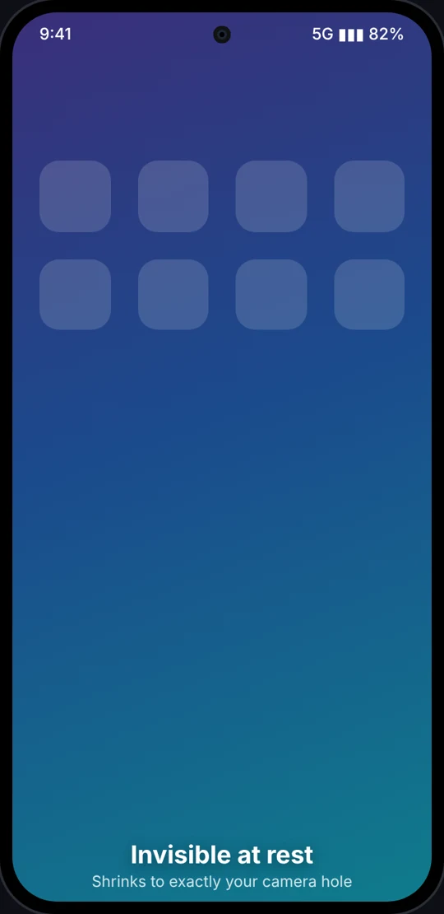
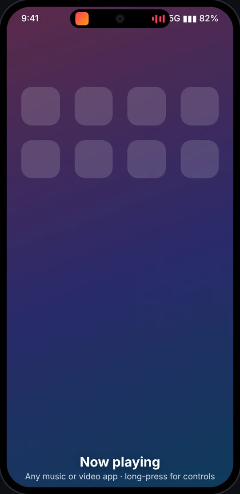
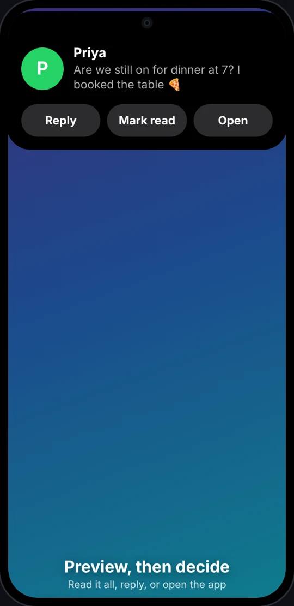
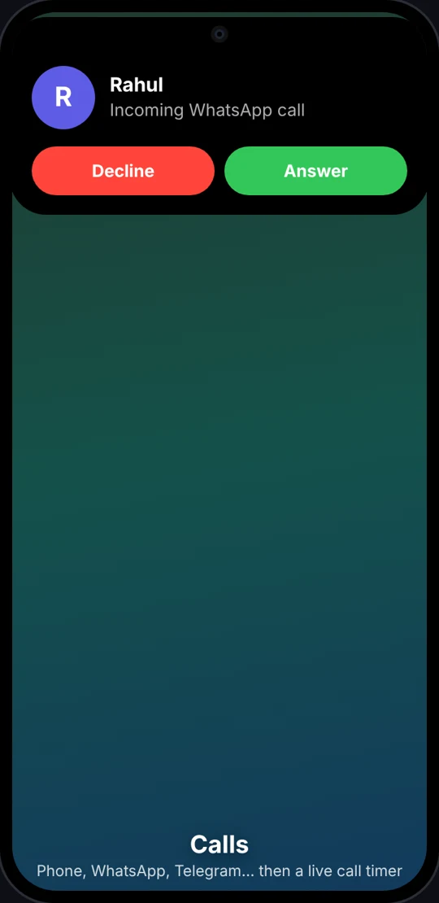
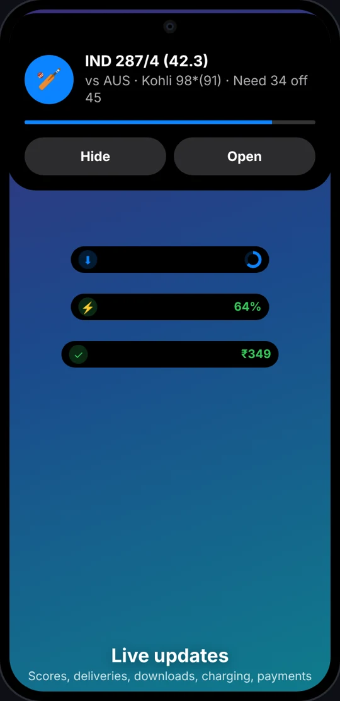
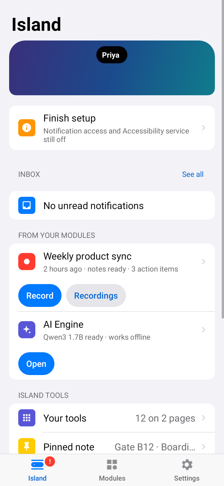
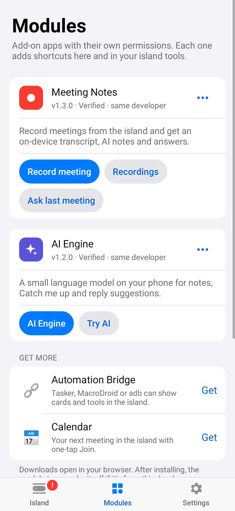
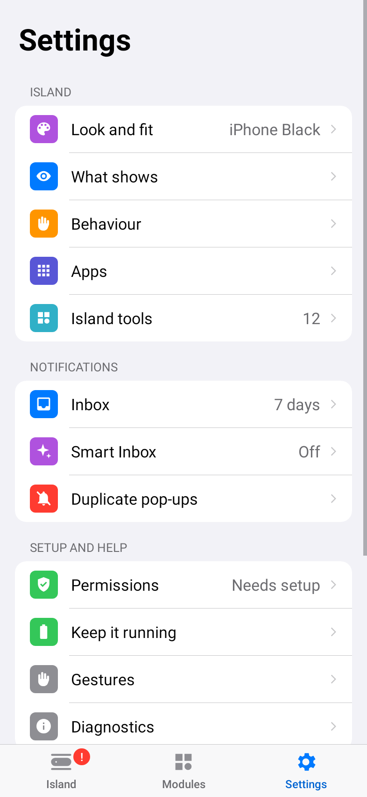
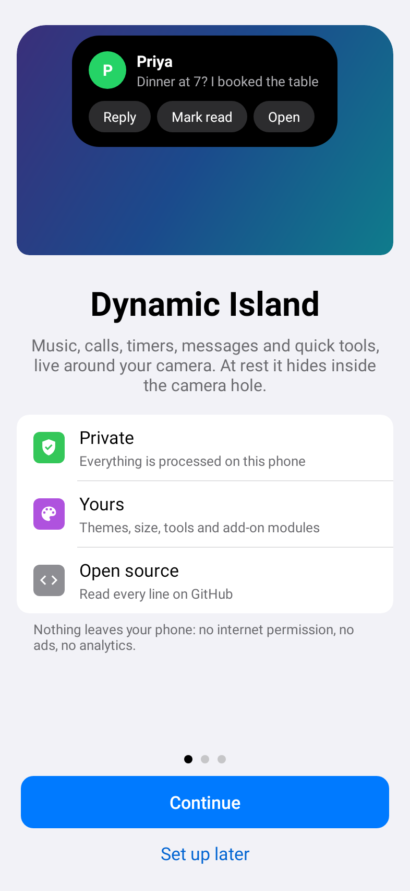
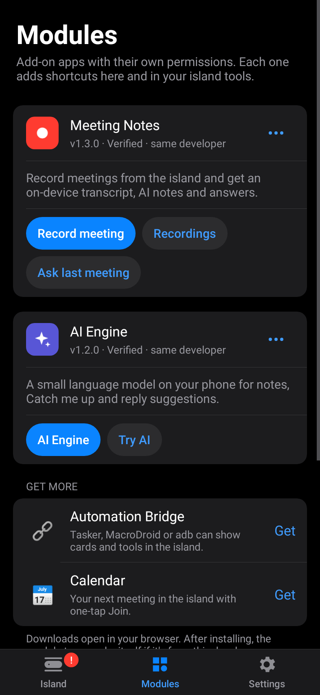

<div align="center">

# Dynamic Island for Android

**An open-source, privacy-first Dynamic Island for any Android 12+ phone with a punch-hole or notch.**
Music, calls, timers, message previews with quick reply, live scores, deliveries, payments, charging and more.
At rest it shrinks into your camera hole and disappears.

[**Website**](https://ajitpal.github.io/dynamic-island-android/) ·
[**Download APK**](https://github.com/ajitpal/dynamic-island-android/releases/latest) ·
[Install guide](docs/INSTALL.md) ·
[Features](docs/FEATURES.md) ·
[How it works](docs/ARCHITECTURE.md) ·
[Privacy](PRIVACY.md)


    

<sub>The island (illustrations).</sub>

    

<sub>The app (rendered from code on every build). Real-device captures from contributors are welcome; see <a href="docs/screenshots/README.md">docs/screenshots</a>.</sub>

</div>

---

## Why this exists

The iPhone's Dynamic Island is a great idea: a small, living glimpse of what your phone is doing. Pixel phones have *Live Updates* chips, and some Android skins have their own islands, but most Android phones get nothing, or an app full of ads that needs network access.

This app aims to be the clean alternative:
- **Open source** (MIT): read every line.
- **No internet permission**, no ads, no analytics. Nothing leaves your phone.
- Works across brands: Xiaomi / Redmi / POCO, Samsung, OnePlus, OPPO, realme, vivo, iQOO, Motorola, Nothing, Pixel and more.

## Features at a glance

<!-- GEN:features -->
| | |
|---|---|
| 🫥 **Invisible at rest** | Shrinks to exactly your camera hole, with a calibrate mode for a pixel-perfect fit |
| 🎵 **Now playing** | Any music or video app: artwork colour, animated bars, seek progress, play/pause/skip |
| 💬 **Preview, then decide** | Tap to read the full notification in the island; quick reply inline (with ✨ suggested replies), or open the app |
| 📞 **Calls** | Answer or decline in the island (phone, WhatsApp, Telegram…), then a live call timer |
| ⏱ **Timers & stopwatch** | From your Clock app or the island's own tools |
| 🏏 **Live updates** | Navigation, deliveries, rides and live scores from any app (Android 16 Live Updates supported) |
| 💳 **Payments** | Confirmation glimpse for Google Wallet and UPI apps (GPay, PhonePe, Paytm, BHIM, CRED) |
| ⚡ **System glimpses** | Charging, low battery, silent/vibrate, DND, earbuds + battery, airplane mode, offline / back online, hotspot, NFC, unlock, flashlight |
| 🔴 **Recording** | Screen and voice recording with a red REC timer, camera/mic in-use dots |
| 🧰 **Island tools** | Long-press the empty island: 25+ tools you choose and arrange, any app, and shortcuts from your modules |
| 📥 **Notification Inbox** | Every notification kept (encrypted, on-device) until you clear it: search, filters, OTP copy, ✨ Catch me up |
| 🚫 **No double pop-ups** | Turn off system banners per app, or move notifications into the island; never pops twice |
| 🎨 **Make it yours** | 7 themes, width, height, roundness, opacity, glow outline, animation speed |
| 📱 **Simple app** | A short first-run setup, then three tabs (Island, Modules, Settings) laid out the way iPhone settings are |
| ⏻ **On/off switch** | Turn the island off and on from the app or a Quick Settings tile; your Inbox keeps working |
| ♿ **Accessible** | Large-text ready, 48 dp touch targets, TalkBack labels, respects reduced motion and your "time to take action" setting |
| 🙈 **Polite** | Hides an app's activity while that app is open, hides message text on the lock screen, per-app on/off |
| 🎙 **Meeting Notes** (module) | Record a meeting from the island or import an audio file: REC timer, live captions, on-device transcript in English, Hindi or Hinglish, playback, AI notes (summary, decisions, action items) and Ask about this meeting. |
| 🗣 **Speech Pack** (module) | Hindi and Hinglish speech-to-text on your phone (Meta's Omnilingual ASR) for Meeting Notes, when the phone's own speech recognition can't do Hindi offline. Hindi in Devanagari, English words in Latin letters. Offline after a one-time download. |
| ✨ **AI Engine** (module) | A small language model on your phone (Qwen3 or Gemma 4 via LiteRT-LM, or Gemini Nano where available) for meeting notes, Catch me up and reply suggestions. Offline after a one-time download. |
| 📅 **Calendar** (module) | Next meeting countdown, a pop-up 5 minutes before with one-tap Join (Meet, Zoom, Teams, Webex), progress while it runs. |
| 🔗 **Automation Bridge** (module) | Tasker, MacroDroid or adb can show cards and tools in the island, protected by a secret key. |
| ⬇️ **Updater** (module) | Keeps the island and every module up to date from GitHub Releases: checks once a day, shows what's new, and installs only after you tap Update and confirm. Off in Modules means no checks at all. |
<!-- /GEN:features -->

Full list and the iPhone / Pixel comparison: **[docs/FEATURES.md](docs/FEATURES.md)**.

### Gestures
| Gesture | Action |
|---|---|
| Tap | Preview the full content (or open the app; set this in Behaviour) |
| Long-press / swipe down | Expand · music controls |
| Empty island: swipe down / long-press | **Inbox** / **your tools** (swipe sideways for more pages) |
| Swipe up or sideways | Shrink back to the pill (the activity keeps running) |
| Tap the side bubble | Switch between two running activities |
| Tap the empty pill | Bring back shrunk activities |

## Modules

Optional add-on apps, each with its own permissions. Modules from this repo switch on when installed, and their shortcuts appear in the island's tools and on the app's **Modules** tab. Anyone can [build a module](docs/MODULES.md), with or without an AI coding agent ([agent guide](docs/modules/AGENT_GUIDE.md)).

<!-- GEN:modules -->
| Module | What it adds | Shortcuts it puts in the island and the app | Permissions |
|---|---|---|---|
| 🎙 **Meeting Notes** 1.4.0 | Record a meeting from the island or import an audio file: REC timer, live captions, on-device transcript in English, Hindi or Hinglish, playback, AI notes (summary, decisions, action items) and Ask about this meeting. | Record meeting, Import audio, Recordings, Ask last meeting | Microphone, Notifications, Internet (one-time model download) |
| 🗣 **Speech Pack** 1.0.0 | Hindi and Hinglish speech-to-text on your phone (Meta's Omnilingual ASR) for Meeting Notes, when the phone's own speech recognition can't do Hindi offline. Hindi in Devanagari, English words in Latin letters. Offline after a one-time download. | Speech Pack, Try it on an audio file | Notifications, Internet (model download only) |
| ✨ **AI Engine** 1.3.0 | A small language model on your phone (Qwen3 or Gemma 4 via LiteRT-LM, or Gemini Nano where available) for meeting notes, Catch me up and reply suggestions. Offline after a one-time download. | AI Engine, Try AI | Notifications, Internet (model download only) |
| 📅 **Calendar** 1.1.0 | Next meeting countdown, a pop-up 5 minutes before with one-tap Join (Meet, Zoom, Teams, Webex), progress while it runs. | Next meeting, Open (settings) | Calendar |
| 🔗 **Automation Bridge** 1.1.0 | Tasker, MacroDroid or adb can show cards and tools in the island, protected by a secret key. | Two automation tools you name, Open (settings) | None |
| ⬇️ **Updater** 1.0.0 | Keeps the island and every module up to date from GitHub Releases: checks once a day, shows what's new, and installs only after you tap Update and confirm. Off in Modules means no checks at all. | Software Update | Internet (GitHub only), Install apps (you confirm each), Notifications |
<!-- /GEN:modules -->

## Install (2 minutes)

1. Download the latest **APK** (and any modules you want) from [Releases](https://github.com/ajitpal/dynamic-island-android/releases/latest) and open it. If Play Protect warns about an unknown developer, tap *More details → Install anyway*.
2. **Android 13+:** Android blocks notification and accessibility access for apps installed from a file. Try the toggle once, then go to *App info → ⋮ → Allow restricted settings*.
3. In the app, turn on **Notification access** and the **Accessibility service**.
4. Follow **"Keep it running"** for your phone brand (the app detects it).
5. Tap the **Try it** chips to see every state.
6. **Stay up to date:** install the **Updater** module too. It checks GitHub once a day and installs new versions after you confirm; the island app itself stays offline.

Step-by-step guides per brand, plus an ADB alternative: **[docs/INSTALL.md](docs/INSTALL.md)**.

## Permissions, honestly

| Permission | Why |
|---|---|
| Notification access | Read notifications and media sessions **on the device** to show them in the island, reply and control playback |
| Accessibility service | Draw the island **above the status bar and lock screen**, and know which app is open (to hide its own activity). **No screen content is read** (`canRetrieveWindowContent=false`). |
| Bluetooth (optional) | Show your earbuds' name |
| Vibrate, network state, Wi-Fi state | Haptics; "offline / back online" and hotspot glimpses |
| **Internet** | **Not requested.** The app can't send anything anywhere. |

Modules ask for their own permissions, only if you install them. For example, Meeting Notes asks for the microphone, and Meeting Notes and AI Engine use the internet only to download their models once.

See [PRIVACY.md](PRIVACY.md).

## Build from source

```bash
git clone https://github.com/ajitpal/dynamic-island-android.git
cd dynamic-island-android
./gradlew assembleDebug            # → app/, modules/automation/, modules/calendar/ … build/outputs/apk/debug/
```
Project layout: `app/` (the island), `module-sdk/` (library for module developers), `modules/*` (first-party add-on apps).
Requires JDK 17+ and the Android SDK (or just open the folder in Android Studio).
Release signing is optional: create `keystore.properties` (git-ignored) with `storeFile`, `storePassword`, `keyAlias` and `keyPassword`.
Without it, release builds fall back to the debug key.

Stack: Kotlin 2.4 · AGP 8.7 · minSdk 31 / targetSdk 35 · coroutines · Material 3 · no Compose · ~2.5 MB APK.

## Contributing

Ideas, bug reports and device reports are very welcome. The most useful thing you can send is a **Diagnostics** screenshot from the bottom of the app's screen together with your phone model. See [CONTRIBUTING.md](CONTRIBUTING.md).

Good first issues: real-device screenshots, translations, three simultaneous activities, a home-screen widget.
What's next, including the add-on module platform: **[ROADMAP.md](ROADMAP.md)**.

## How it was built

This app was designed and built by [Ajit Kumar Pal](https://github.com/ajitpal) in a few short iterations with an AI pair-programmer (Claude), and tested on a real POCO M8. The story, including what went wrong and how each problem was fixed, is in the accompanying blog post.

## License

[MIT](LICENSE) © 2026 Ajit Kumar Pal. "Dynamic Island" is used descriptively; this project is not affiliated with Apple, Google or any phone maker.
