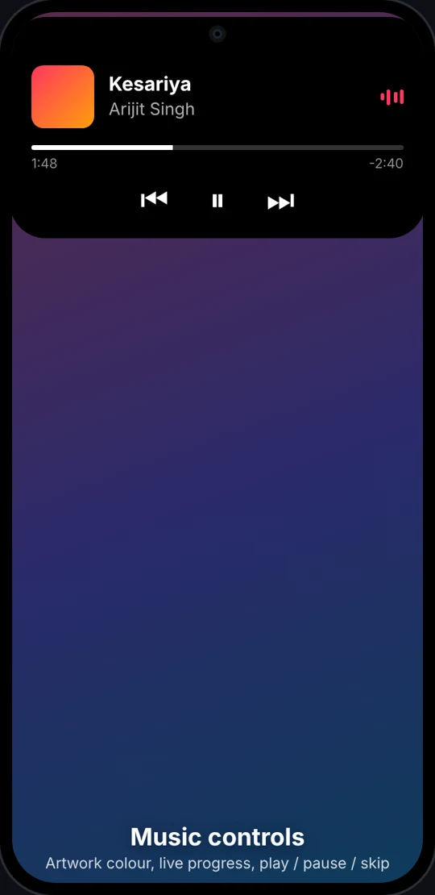
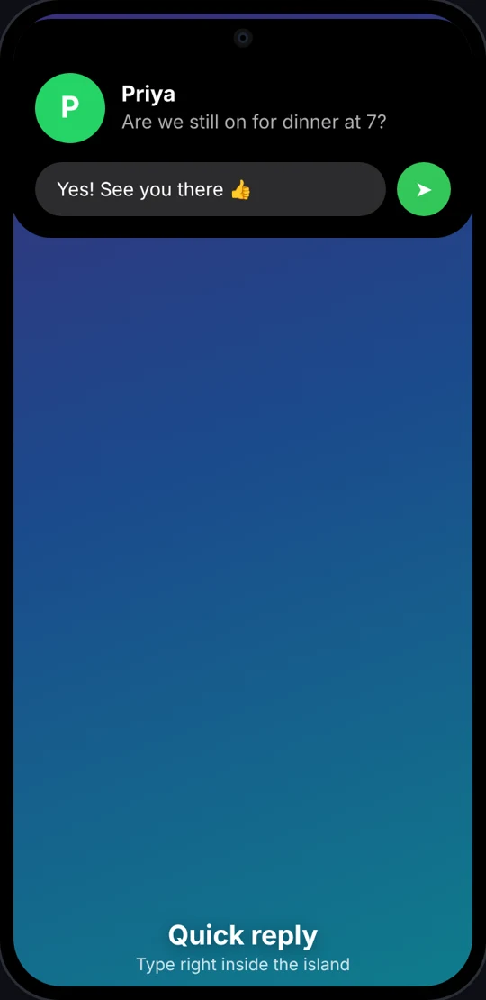
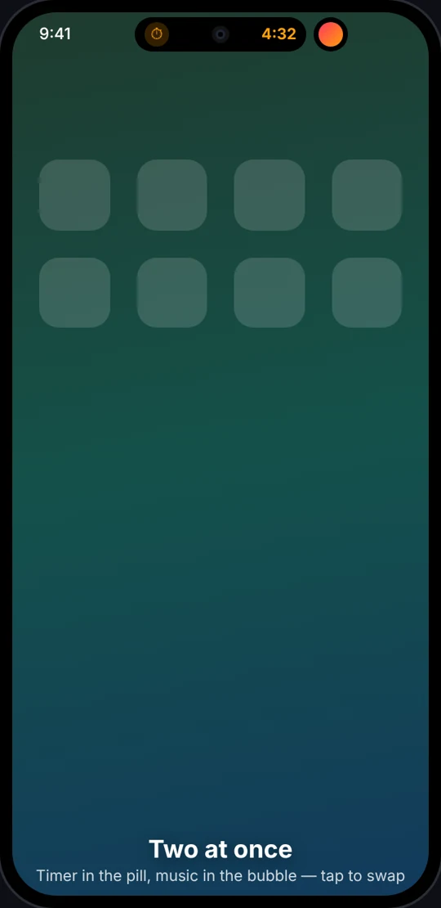
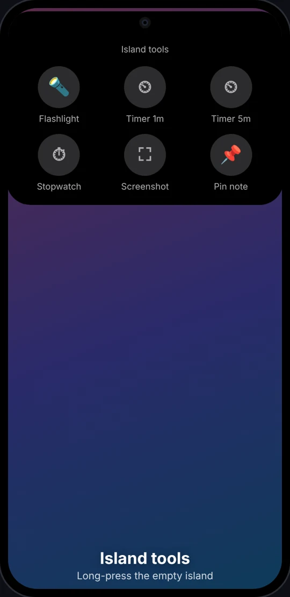
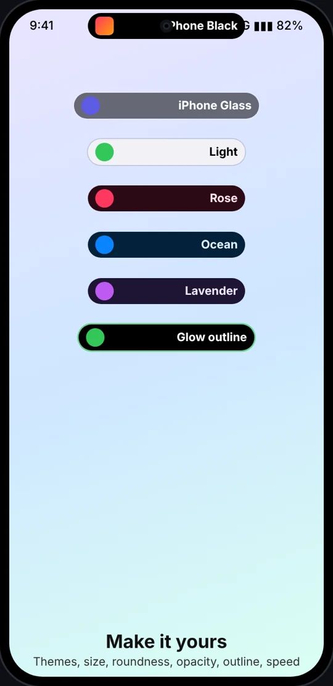

# Features & comparison

How this app compares with Apple's Dynamic Island (iPhone 14 Pro and later) and Google's Android 16 *Live Updates* (status-bar chips on Pixel).

| Feature | iPhone | Pixel / Android 16 | This app |
|---|:---:|:---:|:---:|
| Morphing island around the camera (rest → compact → expanded, spring animation) | ✅ | chip | ✅ |
| **Invisible at rest** (shrinks into the camera hole) | ✅ | – | ✅ + calibrate mode |
| Two activities at once (pill + side bubble), tap to swap | ✅ | – | ✅ |
| Now playing: artwork, waveform, progress, controls | ✅ | partial | ✅ any MediaSession app |
| Incoming call answer/decline, call timer | ✅ | partial | ✅ phone + VoIP (CallStyle) |
| Timers / stopwatch | ✅ | ✅ | ✅ + built-in tools |
| Turn-by-turn navigation | ✅ | ✅ | ✅ navigation notifications |
| Downloads, deliveries, rides, live sports | ✅ (Live Activities) | ✅ | ✅ progress + *Live Updates* + popular apps |
| **Every notification**, with **tap-to-preview** and **inline quick reply** | – | – | ✅ |
| Payment confirmation | ✅ Apple Pay | – | ✅ Google Wallet + UPI apps |
| Unlock animation | ✅ Face ID | – | ✅ |
| Charging / low battery | ✅ | – | ✅ with battery bar |
| Silent / vibrate, Focus | ✅ | – | ✅ ringer modes, Do Not Disturb |
| Earbuds connected + battery | ✅ AirPods | – | ✅ when earbuds report battery |
| Airplane mode, no data / back online, hotspot, NFC | ✅ | – | ✅ |
| Screen & voice recording indicator | ✅ | – | ✅ red REC + timer |
| Camera / mic in-use dots | ✅ | ✅ | ✅ |
| Flashlight on | ✅ | – | ✅ tap to turn off |
| Island tools: 25+ customisable tools + any app, paged | – | – | ✅ |
| **Notification Inbox** (encrypted, until cleared, search, OTP copy) | – | – | ✅ |
| Stop duplicate pop-ups (pop-up guide, move-to-island, no double peeks) | – | – | ✅ |
| Themes, size, roundness, opacity, outline, animation speed | – | – | ✅ |
| Per-app on/off, hide content on lock screen, hide in the app's own screen | partial | partial | ✅ |
| Works offline, no tracking | ✅ | ✅ | ✅ (no internet permission) |

**Not possible on Android** (they depend on Apple's own system): Apple Watch / CarKey unlock, AirDrop, AirPlay, SharePlay, Find My, SIM alerts.

## Island states
   

Illustrations of the real layouts.

## The app (1.9)
Three tabs designed to Apple's Human Interface Guidelines: **Island** (status, Inbox, module tiles, your tools, pinned note, Try it), **Modules** (each module with its shortcuts and a ⋯ menu; Get more from the catalog) and **Settings**. Light and dark, text follows your font size, TalkBack throughout ([ACCESSIBILITY.md](ACCESSIBILITY.md)). Long-press a module tool in the island for that module's shortcuts.

## Add-on modules
Optional apps that add abilities to the island, each with its own permissions (see [MODULES.md](MODULES.md)). Each module's shortcuts appear on its card in the Modules tab and can be added to the island's tools; its icon can be hidden from the app drawer.
- **Meeting Notes**: "Record meeting" island tool, red REC timer with live captions, Pause / Stop in the island, on-device English transcript (Moonshine Small or Tiny), playback with tap-to-jump, share / copy, and with AI Engine: automatic **AI notes** (summary, decisions, action items, open questions; 5 templates) with progress in the island.
- **AI Engine**: on-device language model (Qwen3 0.6B / 1.7B or Gemma 4 E2B on LiteRT-LM), optional GPU, "Try it" box with speed. Powers Meeting Notes (notes and **Ask about this meeting** with tappable timestamps) and Smart Inbox ("Catch me up" in the Inbox or as an island tool, ✨ reply suggestions; opt-in). On phones with **Gemini Nano**, Meeting Notes can use it while on screen, with no download.
- **Calendar**: next-meeting countdown, pop-up 5 minutes before with one-tap Join (Meet, Zoom, Teams, Webex), progress while it runs.
- **Automation Bridge**: Tasker, MacroDroid or adb can show cards and tools in the island.
- **Updater** (recommended): Software Update for the island and every module from GitHub Releases: daily check, what's new, Update All, checksum and signing-key checks, Android's install prompt. The island app stays offline.
